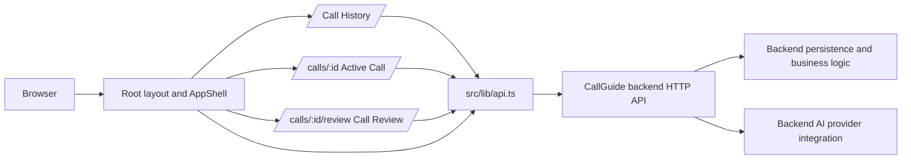

# CallGuide Frontend

This directory contains the CallGuide browser application. It provides the call history workspace, an eight-stage active-call workflow, and a read-only call review. It collects user input and presents call data; the backend owns validation, persistence, health checks, analytics aggregation, and AI-provider requests.

The frontend is a Next.js App Router application. It calls the backend over HTTP using the JSON envelope `{ "data": ..., "error": ... }`. It does not connect directly to PostgreSQL or OpenRouter.

## 1. Frontend overview

The application is split into three practical layers:

- **Presentation and route composition:** `src/app/` defines pages and renders the CallGuide UI.
- **Browser interaction and UI state:** `src/components/` contains the shared shell, start-call form, and animated globe; route components own their filters, drafts, loading state, and user interactions.
- **Backend integration:** `src/lib/api.ts` provides typed request functions and `src/lib/types.ts` describes the data exchanged with the API.

Call and stage records are loaded from and saved to the backend. The UI keeps temporary input and display state in React state while a page is open; there is no frontend local-storage persistence layer.

## 2. Technology stack

Versions below are those declared in `package.json` and may be resolved more precisely by `package-lock.json`.

| Technology | Declared version | Use |
| --- | --- | --- |
| Next.js | `16.4.3` | App Router, route rendering, development and production server |
| React / React DOM | `19.3.0` | Interactive client components and UI state |
| TypeScript | `^5` | Application types and strict checking |
| Tailwind CSS | `^4` | Utility CSS and theme integration; the app also uses substantial hand-authored CSS |
| `@tailwindcss/turbopack` | `^4` | CSS loader configured in `next.config.ts` |
| ESLint | `^9` | Linting with `eslint-config-next` Core Web Vitals and TypeScript rules |
| `cobe` | `^2.0.1` | Animated globe in the start-call panel |

Fonts are loaded in `src/app/layout.tsx` with `next/font/google`: Barlow Condensed, DM Mono, DM Sans, Geist, and Geist Mono. The current design uses Barlow Condensed for display headings, DM Sans for body text, and DM Mono for compact labels and metadata. Geist variables are also loaded and available to styles.

## 3. Application architecture

The application uses the Next.js App Router. Route files are under `src/app`; shared layout and navigation are provided by `AppShell`. The route pages are client components where they need browser state, event handlers, or effects. API calls are centralized in `src/lib/api.ts`; page components do not create a second fetch client.



`src/lib/stages.ts` holds deterministic stage definitions and their default question text. `src/lib/types.ts` contains shared request/response types. No global state library is installed: state belongs to the shell or the route/component that uses it. The backend remains the source of truth after a successful save or reload.

## 4. Application routes

| Route | Purpose and interactions | Data and API calls | Loading, errors, and empty states |
| --- | --- | --- | --- |
| `/` | Call History. Shows date-range metrics, call-volume and outcome charts, callback queue, searchable/filterable call list, and the start-call panel. Users can filter by text, status, outcome, date, and sort order; move through call-history pages; and open or create calls. | `GET /calls` (including query and filter parameters), `GET /calls/callbacks`, `GET /calls/analytics`; creating a call uses `POST /calls` from `StartCallPanel`. | Shows loading status while requests run, inline alert and retry actions for failed analytics/history/callback requests, and empty messages for no calls, callbacks, or completed outcomes. Requests are cancellable when filters change or the page unmounts. |
| `/calls/[id]` | Active Call. Displays the prospect, elapsed timer, stage tracker, stage-specific questions and response fields, notes, structured outcomes, and close-call controls. Users can navigate stages, add custom questions, explicitly request AI question suggestions, save/retry a stage, and close the call. | `GET /calls/:id`; `POST /calls/:id/stages`; `POST /calls/:id/questions` only when the user requests suggestions; `POST /calls/:id/close` to close; `POST /calls/:id/summary` can be called after completion to create a summary. | Loading and error status are announced; load failures have retry behavior. Save status is displayed as saving/saved/error and failed saves can be retried. Completed calls render read-only controls. |
| `/calls/[id]/review` | Review of a saved call: summary, call metadata, stage-by-stage notes and structured results, and recorded question/response details. In-progress records offer a continue-call link; completed calls are presented as read-only. A summary may be requested for a completed call. | `GET /calls/:id`; `POST /calls/:id/summary` when the user requests summary generation. | Loading and load errors have status/alert roles and a retry action. Missing calls show “Call not found.” Missing summaries and empty stage information have explanatory messages; summary failures preserve any existing summary. |

The shell also calls `GET /health` and displays backend, database/persistence, and OpenRouter health information in its status area. Several navigation entries are intentionally marked “Coming Soon”; they are not implemented routes.

## 5. Component architecture

- **`src/app/layout.tsx` — `RootLayout`:** Loads fonts and global CSS, sets document metadata, and wraps route content in `AppShell`.
- **`src/components/app-shell.tsx` — `AppShell` / `ShellFrame`:** Shared navigation, global search, health status, and the history-page layout. The health display can be retried. Global search focuses with Ctrl/Cmd+K, submits search to Call History, and can be blurred with Escape. `GuardedLink` and `useNavigationGuard` let the active-call page save dirty drafts before in-app navigation.
- **`src/components/start-call-panel.tsx` — `StartCallPanel`:** Validates required prospect details, posts a new call, displays errors, then routes to its active-call page. Preparation notes are optional.
- **`src/components/cobe-globe.tsx` — `CobeGlobe`:** Renders the decorative globe using `cobe`; it observes visibility and size, stops animation when appropriate, and respects reduced-motion preference.
- **`src/app/page.tsx` — `HomePage`:** Owns history filters, cursor-based page navigation, analytics, callback pagination, and request loading/error state.
- **`src/app/calls/[id]/page.tsx` — `CallWorkspacePage`:** Owns loaded call state, stage drafts, question interactions, save coordination, timer, and call closure.
- **`src/app/calls/[id]/review/page.tsx` — `ReviewPage`:** Loads and presents the call review and summary-generation state.

The shell, start-call panel, and globe are reusable components. The history, active-call, and review experiences are route-specific. The API client and types are shared utilities rather than UI components.

## 6. Active-call workflow

`src/lib/stages.ts` defines eight fixed stages: Opening, Purpose, Permission, Their Business, Their Need, Objection, Next Step, and Close. The stage tracker lets the user select a stage; Previous/Next controls also save dirty stage data before moving. Progress is based on saved stage state and is not a separate AI decision.

Each stage definition contains an objective, guidance, and deterministic default questions. These questions are available without an AI call. Users may also add custom questions. AI suggestions are optional and are requested only by using the suggestion action; the frontend sends the current call ID and stage number to the backend. The backend may return OpenRouter suggestions or fallback results, and the UI distinguishes errors from the still-available defaults.

A question is represented as a `StageQuestion` with `id`, `question_text`, `source` (`suggested` or `custom`), `asked`, `response`, and `position`. Asked state and responses are editable during an in-progress call. On stage save, the frontend sends the stage's questions together with its notes and structured result. The backend stores question rows alongside stage data. Existing stage data is reconstructed into drafts when the call loads; legacy asked-question/response fields are also read by the frontend for compatibility.

Stage-specific structured fields capture outcomes such as permission, need, objection, next-step details, callbacks, and referral information. Text fields have explicit length limits in the UI. A 900 ms debounce saves changes to the current stage. Stage navigation and guarded in-app navigation attempt to save dirty stages first; the UI exposes retry controls if saving fails. This is server persistence, not browser-draft persistence: edits that have not successfully saved are not guaranteed to survive a browser crash or forced close.

The call timer is derived from `started_at` and updates once a second for an in-progress call. A completed call uses `completed_at` as its end time. Closing a call sends its final outcome and notes; some outcomes require callback scheduling or explicit do-not-call confirmation. Completed calls are read-only. Review summary generation is separate from stage question suggestions and requires a completed call.

## 7. API integration

### Base URL and request conventions

`src/lib/api.ts` reads `NEXT_PUBLIC_API_BASE_URL`. In development, it defaults to `http://localhost:4000` if unset. For a production build it throws if the variable is missing. Requests use `fetch`, send `Content-Type: application/json`, and parse the backend envelope `{ data, error }`. A non-2xx response or a non-null `error` becomes a JavaScript `Error` using the backend error message where available. There is no explicit client timeout. Selected read requests accept `AbortSignal` so the UI can cancel outdated work.

### Frontend endpoint map

| Endpoint | Frontend use |
| --- | --- |
| `GET /health` | Shared shell health indicator (`loadSystemHealth`). |
| `GET /calls` | Call history via `listCallsPage`; sends `limit=10`, `sort`, and optional `q`, `status`, `outcome`, `started_after`, `started_before`, and `cursor`. Pagination metadata is read from `X-Next-Cursor`, `X-Total-Count`, `X-Page-Count`, and `X-Has-More` headers. |
| `POST /calls` | Create a call from the start panel; JSON body contains prospect/call form fields. |
| `GET /calls/:id` | Load active-call or review details (`CallDetail`, including `stageResults` and `summary`). |
| `POST /calls/:id/stages` | Save a stage with `stage_number`, `stage_status`, `notes`, `structured_result`, optional `questions`, and optional `callback_at`. |
| `POST /calls/:id/questions` | Explicit AI-suggestion request with `{ stage_number, force_refresh }`; result includes status, source, and question recommendations. |
| `POST /calls/:id/close` | Close with `final_outcome`, `final_notes`, and optional do-not-call confirmation or callback time. |
| `POST /calls/:id/summary` | Request a summary for a completed call. |
| `GET /calls/callbacks` | Load upcoming/scheduled callback records. |
| `GET /calls/analytics` | Load aggregated metrics and chart data. Sends `period`, browser `timezone`, and optional `from`/`to` dates. |

The analytics response includes totals (`total`, `completed`, `in_progress`, `follow_ups`), time buckets, and outcome counts. The UI derives bar heights and chart ticks from the returned bucket counts, and derives donut segment angles and displayed percentages from returned outcome counts. Chart values are not hard-coded. The analytics itself is fetched from the backend rather than recomputed from only the currently visible call-history page. The callback queue fetches its records and paginates them in the browser at five rows per page; the call-history API page size is ten.

## 8. State management and persistence

- **Backend-owned:** Calls, status/outcome, timestamps, stage records, structured results, questions, callbacks, and summaries. A successful request is required for these changes to persist.
- **Route-local React state:** History filters and pages, analytics result, callback page, active-call stage drafts and save indicators, review loading state, and form values/errors.
- **Shell state:** Health status and retry, global-search text, and navigation guard registration.
- **No browser storage:** The frontend does not currently use `localStorage` or `sessionStorage` for call data or drafts.

History filters trigger new requests and reset cursor history. Search has a short debounce. Active-call data is loaded from the API when the route opens; stage edits are debounced before posting. A navigation guard saves outstanding dirty stages for links routed through the shared guarded-navigation mechanism. The active-call timer and callback “overdue/due today” labels are computed in the browser from saved timestamps and current time. No optimistic persistence is claimed: the UI tracks save state and treats the backend response as confirmation.

## 9. Styling and design system

Global CSS and most component-specific styles live in `src/app/globals.css`. Tailwind v4 is imported there, and a subset of utility color classes is remapped to the CallGuide dark surfaces for older utility-based markup. CSS classes prefixed `cg-` implement the product layout and components. No standalone PostCSS configuration file is present; CSS loading is configured through the Tailwind Turbopack loader in `next.config.ts`.

Core CSS variables include:

| Token | Value | Use |
| --- | --- | --- |
| `--cg-bg` | `#070d14` | Main page background |
| `--cg-surface` | `#0b131d` | Cards and panels |
| `--cg-surface-raised` | `#0e1925` | Raised surface |
| `--cg-border` | `#1b2a3a` | Panel and divider borders |
| `--cg-text` | `#edf4ff` | Primary text |
| `--cg-text-secondary` | `#bdcde0` | Secondary text |
| `--cg-muted` | `#91a4bb` | Muted labels |
| `--cg-dim` | `#71859a` | Dim labels |
| `--cg-accent` | `#0866ff` | Primary blue action/chart color |
| `--cg-accent-hover` | `#2680ff` | Hover blue |
| `--cg-success` | `#00d7a0` | Success state |
| `--cg-warning` | `#ffbd25` | Warning state |
| `--cg-error` | `#ff514e` | Error state |
| `--cg-cyan` | `#42c8ff` | Supporting highlight |

The history shell uses a three-column desktop arrangement (navigation, content, start-call sidebar). Its sidebar is sticky on wide layouts. At `1200px`, the start panel moves below the main content and analytics becomes one column. At `850px`, navigation becomes a horizontally scrolling row and active-call content stacks. At `560px`, history filters and call rows are further simplified, and metric cards use two columns. These are CSS breakpoints in the existing stylesheet, not a mobile-first Tailwind configuration.

## 10. Environment variables

| Variable | Example | Required? | Purpose |
| --- | --- | --- | --- |
| `NEXT_PUBLIC_API_BASE_URL` | `http://localhost:4000` | Optional in development (this fallback is used); required for production builds | Base URL of the CallGuide backend API. |

A starter value is in `.env.example`. For local Next.js development, copy it to `.env.local` in `frontend/`. Do not put database credentials, AI-provider keys, or any other server secret in a `NEXT_PUBLIC_` variable: Next.js exposes such values to browser code and compiled client bundles. Backend configuration belongs in the backend environment.

## 11. Local development setup

Use Node.js and npm compatible with the repository lockfile. In one terminal, start the backend using its own environment configuration; the frontend expects it at `http://localhost:4000` by default. In another terminal:

```bash
cd frontend
npm ci
cp .env.example .env.local
npm run dev
```

Open `http://localhost:3000`. If the backend runs at another address, set that URL in `frontend/.env.local` as `NEXT_PUBLIC_API_BASE_URL` and restart the frontend server.

Available frontend scripts:

```bash
npm run lint
npx tsc --noEmit
npm run build
npm run start
```

`npm run start` serves the most recent production build and normally follows `npm run build`. `package.json` does not define a frontend test script. The backend has its own setup and environment requirements; use `backend/.env.example` as a template and keep its secrets out of frontend configuration.

## 12. Production build and deployment

Build and serve locally with:

```bash
cd frontend
npm ci
NEXT_PUBLIC_API_BASE_URL=https://your-backend.example npm run build
npm run start
```

Replace the placeholder with the reachable backend API origin. `NEXT_PUBLIC_API_BASE_URL` is embedded for browser use, so it must be set in the deployment environment when building. For Vercel, configure the frontend project root as `frontend`, set the variable for the relevant deployment environments, and deploy the Next.js project. Confirm that the backend accepts the deployed frontend origin through its CORS configuration; the backend currently uses `FRONTEND_ORIGIN` for that purpose. This README does not assert that a Vercel deployment exists.

To check connectivity, open the deployed site, confirm the shell health indicator can load, and exercise a read route such as Call History. In browser developer tools, inspect the Network panel for requests to the configured API origin. A successful frontend build alone does not confirm backend reachability, CORS configuration, database availability, or AI-provider configuration.

Common deployment issues include an unset API URL (production build error), an incorrect URL or path, backend CORS allowing only a different origin, a backend not reachable from the browser, or missing backend/database/AI-provider configuration. AI suggestions and summaries depend on backend configuration; the history and deterministic call workflow are separate from the AI request path.

## 13. Error handling and troubleshooting

| Symptom | Likely cause / frontend behavior | What to check |
| --- | --- | --- |
| Health shows unavailable; pages fail to load | Backend cannot be reached or returns an error. The shell health request can be retried; route requests show inline errors. | Backend process and port, `NEXT_PUBLIC_API_BASE_URL`, browser Network/Console, and CORS response. |
| “Call not found” or load error on `/calls/:id` | The backend returns a not-found or other API error; the review route also renders a missing-call state. | Verify the ID and that it exists in the backend’s configured persistence store. |
| Stage save shows an error | The `POST /calls/:id/stages` request failed; the dirty state remains available for retry while the page is open. | Network response, backend logs, connectivity, and whether the call is still editable. Avoid navigating away until the save succeeds. |
| AI question suggestions fail | The explicit question-generation request failed or returned an unavailable result. The UI reports an error; deterministic defaults remain available. | Backend AI provider configuration and API response. AI suggestions are optional. |
| Summary generation fails | Summary API request failed. An existing summary remains displayed if one was already loaded. | Call completion state, backend AI configuration, and API response. |
| Production build complains about API URL | `NEXT_PUBLIC_API_BASE_URL` was missing when building in production mode. | Set it in the build/deployment environment and rebuild. |
| Analytics or callbacks show an error | Their specific requests failed; each section has a retry control. | Backend endpoint availability, date/time-zone values, CORS, and network response. |
| `npm run lint` or TypeScript check fails | A source/configuration issue, not a runtime API issue. | Read the first reported file and line; run `npm run lint` or `npx tsc --noEmit` from `frontend/`. |

The shared request helper expects JSON response envelopes. It does not set a request timeout; `AbortSignal` is used for selected read operations and cleanup, not as a universal timeout.

## 14. Accessibility and responsive design

The implementation uses semantic navigation, headings, sections, tables, labels, and buttons. Form fields generally have visible or screen-reader labels; question response textareas have question-specific `aria-label` values. Loading and save states use status roles/live announcements, errors use alert roles, charts expose textual accessible labels, and the stage tracker uses `aria-current="step"`. Focus-visible controls receive a visible outline. Global search supports Ctrl/Cmd+K and Escape. The globe observes `prefers-reduced-motion`.

Responsive layout rules are described in the styling section. At smaller widths, navigation scrolls horizontally, side panels move into the content flow, and dense call information is reduced or hidden. There is no separate mobile route or native mobile application. Accessibility is not represented as a formal audit or conformance claim; verify keyboard flow, contrast, screen-reader output, and narrow viewport behavior when changing these interfaces.

## 15. Known limitations

- Only Call History, Active Call, and Call Review are implemented as routes; other shell navigation items are placeholders.
- Call-history API pages use a fixed limit of ten. The callback queue loads its callback collection and displays five records per client-side page.
- Active-call drafts live in memory until successfully posted. There is no offline queue or browser-local recovery mechanism.
- There is no frontend test script in `package.json`.
- AI question suggestions and call summaries require backend AI configuration and can fail independently of deterministic question content and normal call data entry.
- The UI expects JSON API envelopes; the request layer has no configured timeout.
- Deployment, production monitoring, and a formal accessibility audit are not verified by the frontend source.

## 16. Future development guidance

| Change area | Start here |
| --- | --- |
| Call History layout, filters, statistics, chart, callback queue | `src/app/page.tsx`; adjust related `cg-history-*`, `cg-chart-*`, and `cg-callback-*` rules in `src/app/globals.css`. Keep analytics based on `CallAnalytics` returned by the backend. |
| Active-call fields, stage flow, draft/save behavior | `src/app/calls/[id]/page.tsx`. Preserve dirty-state handling, save status, navigation guard, and read-only behavior for completed calls. |
| Stage names, objectives, guidance, deterministic questions | `src/lib/stages.ts`; keep stage numbers aligned with the backend stage contract and UI-specific stage fields. |
| Question interaction and persistence shape | Active call route and `StageQuestion` in `src/lib/types.ts`; backend owns saved question rows. Keep `question_text`, `source`, `asked`, `response`, and `position` consistent. |
| Call Review presentation and summary request | `src/app/calls/[id]/review/page.tsx`; summary data types are in `src/lib/types.ts` and requests in `src/lib/api.ts`. |
| Endpoint paths, request options, response typing | `src/lib/api.ts` and `src/lib/types.ts`; confirm any contract change against `backend/src/server.ts` and backend validation/store code. |
| Shared navigation, health, global search, navigation guard | `src/components/app-shell.tsx`. |
| Start-call validation and form behavior | `src/components/start-call-panel.tsx`. |
| Brand tokens, responsive rules, shared component styling | `src/app/globals.css`; font setup is in `src/app/layout.tsx`. |

When changing an API contract, update the client types and UI error/loading states alongside the backend contract. Keep provider credentials server-side and preserve the distinction between deterministic defaults and optional generated suggestions.
